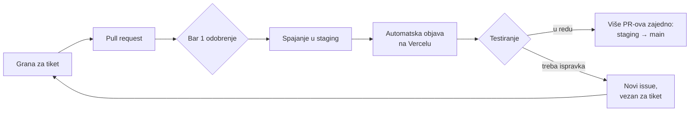

# Kako radimo na projektu

Na Kuki i Motici sada radi više ljudi, pa je teže pratiti šta je spojeno i šta je spremno za objavu. Zato svaka izmena prolazi isti put: pregled koda, grana `staging`, testiranje, pa tek onda `main`.

## Pravila

### 1. Svaki PR traži bar jedno odobrenje

PR se ne spaja dok ga bar jedna osoba ne pregleda i ne odobri (**Approve**).

Čim se otvori PR, issue-u za koji je otvoren dodaje se labela `ready for review`. To radi GitHub sam, za issue iz „Closes #…“ u opisu PR-a ili iz imena grane (npr. `44-…`). Dok je PR draft, labela se skida, a vraća se kad se PR označi kao **Ready for review**.

### 2. Odobren PR se spaja u `staging`

Ciljna grana svakog PR-a je `staging`, ne `main`.

### 3. Izmene se testiraju na stagingu

Staging se objavljuje na **Vercelu**, automatski posle svakog spajanja u `staging`; ništa ne treba pokretati ručno. Kada se nova verzija pojavi na Vercelu, Tijana (i svako ko želi da pomogne u testiranju) proverava implementaciju i javlja da li je sve u redu.

> **Važno: staging radi sa produkcijskom bazom.** Sve što se napravi tokom testiranja (prijave, akcije, fotografije, prijave sadržaja, test nalozi) vide i pravi korisnici. Zato se **posle svakog testiranja na stagingu obavezno obrišu svi test podaci**.

Produkcija ostaje na GitHub Pages i objavljuje se sama kada se `staging` spoji u `main`. Cloud Functions, ekstenzija za e-poštu i Firestore/Storage pravila se i dalje objavljuju ručno (vidi [README → Obaveštenja e-poštom](README.md#obaveštenja-e-poštom)).

### 4. Na `main` ide više PR-ova odjednom

Ne objavljujemo svaki PR posebno. Kada se na stagingu skupi više proverenih PR-ova, `staging` se spaja u `main`. Tako se sve testira na stagingu, a na `main` stiže samo ono što je potvrđeno.

- U `main` se spaja samo grana `staging`; PR iz bilo koje druge grane GitHub blokira.
- PR `staging` → `main` odobrava [@svilimonovicQA](https://github.com/svilimonovicQA) ili [@sekuchu](https://github.com/sekuchu) (spisak je u [.github/CODEOWNERS](.github/CODEOWNERS)).
- Spaja se dugmetom **Create a merge commit** (ne squash), da `staging` i `main` ostanu usklađeni.

### 5. Ispravka za nešto što je već na stagingu ide kroz novi issue

Ako nešto što je već na stagingu treba popraviti, otvara se **novi issue**. U njemu, u komentaru ili u opisu PR-a jasno se navede na koji se tiket ispravka odnosi (na primer „Ispravka za #44“).

### 6. Release Notes

Uvodimo Release Notes: spisak tiketa koji su ušli u svaku objavu. Tako i mi i svi ostali lako vidimo šta je prošlo. Prave se same, na stranici [Releases](https://github.com/ocistimo-novi-sad/ocistimo-novi-sad.github.io/releases):

- Posle svakog spajanja u `staging` ažurira se nacrt **„Sledeća verzija“**: spisak PR-ova koji su na stagingu, a još nisu na produkciji. Nacrt vide samo članovi tima.
- Posle spajanja `staging` → `main` nacrt postaje javna objava sa datumom (npr. `v2026.11.04`).
- PR-ovi su razvrstani po labeli: `enhancement` → Novo, `bug` → Ispravke, `accessibility` → Pristupačnost, `documentation` → Dokumentacija, ostalo → Ostalo. Zato svaki PR treba da ima labelu.
- Labela se stavlja sama: prepisuje se sa issue-a iz „Closes #…“ (ili iz imena grane, npr. `44-…`). „Ispravka za #…“ i grane `bug-…`/`fix-…` dobijaju `bug`, `docs-…` dobija `documentation`, a `feat-…` dobija `enhancement`. Ako labela ne može da se odredi, check **labela** pada i PR ne može da se spoji dok autor ne doda labelu ručno.

## Ukratko, za svaki PR

- [ ] PR je otvoren ka grani `staging`.
- [ ] U opisu PR-a piše tiket („Closes #…“ ili „Ispravka za #…“).
- [ ] Issue ima labelu `ready for review` (dodaje se sama kad PR ima „Closes #…“).
- [ ] PR ima labelu (`enhancement`, `bug`, …) zbog Release Notes; najčešće se doda sama sa issue-a.
- [ ] Ima bar jedno odobrenje pre spajanja.
- [ ] Posle objave na staging, tester je potvrdio da radi.
- [ ] Posle testiranja na stagingu obrisani su svi test podaci (staging koristi produkcijsku bazu).
- [ ] Ako je ovo ispravka, u issue-u ili PR-u piše na koji se tiket odnosi.
