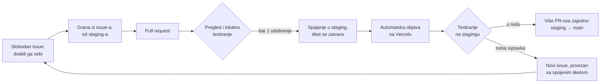

# Kako radimo na projektu

Na Kuki i Motici sada radi više ljudi, pa je teže pratiti šta je spojeno i šta je spremno za objavu. Zato svaka izmena prolazi isti put: preuzimanje tiketa, pregled koda i lokalno testiranje, spajanje u `staging`, testiranje na stagingu, pa tek onda `main`.



## Preuzimanje tiketa

Da dvoje ljudi ne bi radilo na istoj stvari, tiket se preuzima ovako:

1. Izaberi issue koji **nema nikog u polju Assignees** i dodeli ga sebi (**assign yourself**). Time je jasno da je tiket zauzet, pa ne treba posebno da se dogovaramo u grupi.
2. Granu napravi iz samog issue-a: u desnoj koloni, pod **Development**, klikni **Create a branch**. Grana se pravi od `staging`-a (to je podrazumevana grana repoa), a njeno ime počinje brojem tiketa (npr. `44-…`), pa se issue i PR posle sami povezuju (vidi pravila 1 i 6).
3. Preuzmi granu lokalno komandom koju GitHub ponudi (npr. `git fetch origin` i `git switch 44-…`) i kreni sa radom.

Ako ti treba povratna informacija ili smernica, ili ti nešto nije jasno, napiši komentar u issue-u i označi nas u njemu. Ako ipak odustaneš od tiketa, skini se sa Assignees, da bi drugi mogli da ga preuzmu.

### Ime grane

Od imena grane zavisi koju labelu PR dobija za Release Notes (pravilo 6), ako je ne dobije na drugi način.

| Ime grane počinje sa | PR dobija labelu | Primer |
|---|---|---|
| brojem tiketa | labelu tog issue-a | `44-filter-po-statusu` |
| `feat-` ili `feature-` | `enhancement` | `feat-deljenje-akcije` |
| `bug-` ili `fix-` | `bug` | `fix-mapa-na-telefonu` |
| `docs-` ili `doc-` | `documentation` | `docs-pokretanje-lokalno` |

- **Grana napravljena iz issue-a** (`44-…`) je najbolji izbor: povezuje se sa tiketom i preuzima njegovu labelu. Zato proveri da issue ima labelu (`enhancement`, `bug`, `accessibility` ili `documentation`). Ako je nema, prefiks ne pomaže, jer ime počinje brojem, pa labelu dodaj na issue ili na PR.
- **Prefiks se koristi za granu bez tiketa.** Mora da bude na samom početku imena i malim slovima: `fix-44-…` daje `bug`, ali `44-fix-…` ne daje.
- Za `accessibility` prefiks ne postoji; ta labela se dodaje na issue ili na PR.
- Labela koju PR već ima uvek ima prednost i ništa je ne menja.

## Pokretanje lokalno

Potreban je Node 22 (vidi [.nvmrc](.nvmrc)).

```sh
npm ci
npm run dev
```

Bez `.env.local` aplikacija radi u **demo režimu**: izmišljeni primeri, bez naloga, moderacije i e-pošte (vidi [Kako aplikacija radi → Demo režim](docs/use-cases.md#12-demo-režim)). To je dovoljno za većinu izmena u interfejsu.

Za rad sa pravim podacima kopiraj [.env.example](.env.example) u `.env.local` i popuni vrednosti iz Firebase konzole (Project settings → Your apps). Te vrednosti nisu tajne; podatke štite `firestore.rules` i `storage.rules`.

> **Važno:** aplikacija se ne povezuje na Firebase emulatore, iako su navedeni u `firebase.json`. Sa popunjenim `.env.local` lokalna verzija, kao i staging, radi sa **produkcijskom bazom**. Posle testiranja obriši sve test podatke.

Pre otvaranja PR-a proveri da prolazi build (uključuje i proveru tipova):

```sh
npm run build
```

Ako menjaš Cloud Functions (folder `functions/`):

```sh
npm --prefix functions ci
npm --prefix functions run build
```

Ulogu administratora dodeljuje vlasnik projekta u Firebase konzoli: u Firestore-u napravi dokument `admins/{uid}`, gde je `uid` korisnikov ID iz Authentication. Sadržaj dokumenta nije bitan, proverava se samo da postoji. Moderatore posle toga dodeljuje administrator iz aplikacije.

## Pravila

### 1. Svaki PR traži bar jedno odobrenje

PR se ne spaja dok ga bar jedna osoba ne pregleda i ne odobri (**Approve**). Odobrenje se poništava posle svakog novog push-a na granu PR-a, pa PR tada treba ponovo odobriti.

Čim se otvori PR, issue-u za koji je otvoren dodaje se labela `ready for review`. To radi GitHub sam, za issue iz reda u opisu PR-a koji počinje sa „Closes #…“ (ili „Fixes #…“, „Resolves #…“) i iz broja na početku imena grane (npr. `44-…`). Broj pomenut negde u tekstu se ne računa. Dok je PR draft, labela se skida, a vraća se kad se PR označi kao **Ready for review**.

### 2. Odobren PR se spaja u `staging`

Ciljna grana svakog PR-a je `staging`, ne `main`. `staging` je podrazumevana grana repoa, pa novi PR sam cilja nju.

- Spaja se dugmetom **Create a merge commit** ili **Squash and merge**. Rebase nije dozvoljen.
- Pre spajanja mora da prođe kontrola **labela** (vidi pravilo 6).
- Direktan push, force push i brisanje grane `staging` nisu dozvoljeni; sve ide kroz PR.
- „Closes #…“ zatvara issue čim se PR spoji u `staging`, ne tek posle objave na `main`. Šta je stvarno objavljeno vidi se u [Releases](https://github.com/ocistimo-novi-sad/ocistimo-novi-sad.github.io/releases).

### 3. Testiranje: prvo lokalno, pa na stagingu

Svaka izmena se testira dva puta: pre spajanja na svom računaru, a posle spajanja na stagingu.

**Pre spajanja — lokalno.** Otvoren PR se proverava tako što se njegova grana preuzme lokalno i aplikacija pokrene (vidi [Pokretanje lokalno](#pokretanje-lokalno)):

```sh
git fetch origin
git switch ime-grane
npm ci
npm run dev
```

Sa GitHub CLI-jem prva dva reda zamenjuje `gh pr checkout <broj PR-a>`. PR se odobrava (pravilo 1) tek kada izmena lokalno radi kako treba.

**Posle spajanja — na stagingu.** Kada se PR spoji u `staging`:

- tiket iz „Closes #…“ se sam zatvara;
- PR se pojavljuje u nacrtu Release Notes **„Sledeća verzija“** (pravilo 6);
- staging se sam objavljuje na **Vercelu**, ništa ne treba pokretati ručno.

Kada se nova verzija pojavi na Vercelu, Tijana (i svako ko želi da pomogne u testiranju) prolazi kroz PR-ove iz nacrta „Sledeća verzija“ i javlja da li je sve u redu. Ako nešto ne radi, otvara se novi issue (pravilo 5).

> **Važno: staging radi sa produkcijskom bazom.** Sve što se napravi tokom testiranja (prijave, akcije, fotografije, prijave sadržaja, test nalozi) vide i pravi korisnici. Zato se **posle svakog testiranja na stagingu obavezno obrišu svi test podaci**.

Produkcija ostaje na GitHub Pages i objavljuje se sama kada se `staging` spoji u `main`. Cloud Functions, ekstenzija za e-poštu i Firestore/Storage pravila se i dalje objavljuju ručno (vidi [README → Obaveštenja e-poštom](README.md#obaveštenja-e-poštom)).

### 4. Na `main` ide više PR-ova odjednom

Ne objavljujemo svaki PR posebno. Kada se na stagingu skupi više proverenih PR-ova, `staging` se spaja u `main`. Tako se sve testira na stagingu, a na `main` stiže samo ono što je potvrđeno.

- U `main` se spaja samo grana `staging`. Kontrola **samo-sa-staginga** pada na PR-u iz bilo koje druge grane, i GitHub ga blokira.
- PR `staging` → `main` sam dobija labelu `objava`. Ne treba mu „Closes #…“ ni labela iz pravila 6, jer su tiketi već navedeni u PR-ovima ka `staging`-u, a sam taj PR ne ulazi u Release Notes.
- PR `staging` → `main` odobrava [@svilimonovicQA](https://github.com/svilimonovicQA) ili [@sekuchu](https://github.com/sekuchu) (spisak je u [.github/CODEOWNERS](.github/CODEOWNERS)). GitHub čita CODEOWNERS sa `main`-a, pa izmena spiska važi tek kada stigne na `main`.
- Kada jedno od njih odobri, dugme Merge može da pritisne svako sa `write` pristupom. Repo pripada ličnom nalogu, pa GitHub ne dozvoljava da se to ograniči na određene osobe.
- Dozvoljen je samo merge commit, pa dugme glasi samo **Merge pull request**, bez izbora Squash i Rebase. Tako `staging` i `main` ostaju usklađeni: squash bi napravio commit koji ne postoji na `staging`-u, i sledeće spajanje bi imalo konflikte.
- Direktan push, force push i brisanje grane `main` nisu dozvoljeni.

### 5. Ispravka za nešto što je već na stagingu ide kroz novi issue

Zatvoren tiket se ne otvara ponovo. Ako se pri testiranju na stagingu nađe problem u spojenom PR-u, otvara se **novi issue** i povezuje sa tiketom tog PR-a: u opisu novog issue-a (ili u opisu PR-a sa ispravkom) napiše se „Ispravka za #44“. GitHub tada u #44 prikaže link ka novom issue-u, pa se iz oba tiketa vidi kako su povezani.

„Ispravka za #44“ ne zatvara #44 i ne dodaje mu `ready for review`. Ako PR nema labelu, a ni issue iz „Closes #…“ je nema (ili takvog reda nema), PR zbog toga dobija labelu `bug` (vidi pravilo 6).

### 6. Release Notes

Uvodimo Release Notes: spisak PR-ova (a preko njih i tiketa) koji su ušli u svaku objavu. Tako i mi i svi ostali lako vidimo šta je prošlo. Prave se same, na stranici [Releases](https://github.com/ocistimo-novi-sad/ocistimo-novi-sad.github.io/releases):

- Posle svakog spajanja u `staging` ažurira se nacrt **„Sledeća verzija“**: spisak PR-ova spojenih od poslednje objave, tj. onih koji su na stagingu, a još nisu na produkciji. Nacrt vide samo članovi tima.
- Posle spajanja `staging` → `main` pravi se javna objava sa tagom po datumu (npr. `v2026.11.04`, a `v2026.11.04-2`, `-3`… ako je istog dana bilo više objava) i naslovom „Objava DD.MM.GGGG.“. Nacrt se tada briše.
- PR-ovi su razvrstani po labeli: `enhancement` → Novo, `bug` → Ispravke, `accessibility` → Pristupačnost, `documentation` → Dokumentacija, ostalo → Ostalo. PR-ovi sa labelama `objava`, `duplicate` i `wontfix` se izostavljaju. Zato svaki PR ka `staging`-u treba da ima labelu.
- Labela se stavlja sama ako je PR nema. Prvo se prepisuje sa issue-a iz „Closes #…“ (ili iz imena grane, npr. `44-…`). Ako issue nema labelu, „Ispravka za #…“ u opisu daje `bug`, a ako ni toga nema, odlučuje prefiks imena grane (vidi [Ime grane](#ime-grane)). Ako labela ne može da se odredi, kontrola **labela** pada i PR ne može da se spoji. Kada autor doda labelu ručno, kontrola se sama ponovo pokreće i prolazi.

## Ukratko, za svaki PR

- [ ] Issue je bio slobodan i dodeljen je tebi, a grana je napravljena iz njega (od `staging`-a).
- [ ] PR je otvoren ka grani `staging`.
- [ ] U opisu PR-a piše tiket („Closes #…“ ili „Ispravka za #…“).
- [ ] Issue ima labelu `ready for review` (dodaje se sama kad PR nije draft i ima „Closes #…“ ili broj tiketa na početku imena grane).
- [ ] PR ima labelu (`enhancement`, `bug`, …) zbog Release Notes; najčešće se doda sama sa issue-a.
- [ ] Ko pregleda PR, preuzeo je granu i lokalno proverio izmenu.
- [ ] Ima bar jedno odobrenje pre spajanja.
- [ ] Posle objave na staging, tester je potvrdio da radi.
- [ ] Posle testiranja na stagingu obrisani su svi test podaci (staging koristi produkcijsku bazu).
- [ ] Ako je ovo ispravka, u issue-u ili PR-u piše na koji se tiket odnosi.
