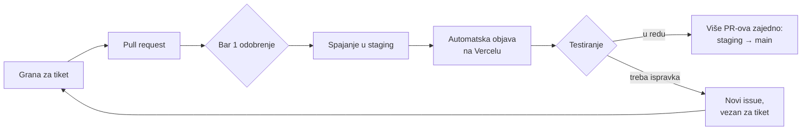

# Kako radimo na projektu

Na Kuki i Motici sada radi više ljudi, pa je teže pratiti šta je spojeno i šta je spremno za objavu. Zato svaka izmena prolazi isti put: pregled koda, grana `staging`, testiranje, pa tek onda `main`.

## Pravila

### 1. Svaki PR traži bar jedno odobrenje

PR se ne spaja dok ga bar jedna osoba ne pregleda i ne odobri (**Approve**). Odobrenje se poništava posle svakog novog push-a na granu PR-a, pa PR tada treba ponovo odobriti.

Čim se otvori PR, issue-u za koji je otvoren dodaje se labela `ready for review`. To radi GitHub sam, za issue iz reda u opisu PR-a koji počinje sa „Closes #…“ (ili „Fixes #…“, „Resolves #…“) i iz broja na početku imena grane (npr. `44-…`). Broj pomenut negde u tekstu se ne računa. Dok je PR draft, labela se skida, a vraća se kad se PR označi kao **Ready for review**.

### 2. Odobren PR se spaja u `staging`

Ciljna grana svakog PR-a je `staging`, ne `main`. `staging` je podrazumevana grana repoa, pa novi PR sam cilja nju.

- Spaja se dugmetom **Create a merge commit** ili **Squash and merge**. Rebase nije dozvoljen.
- Pre spajanja mora da prođe kontrola **labela** (vidi pravilo 6).
- Direktan push, force push i brisanje grane `staging` nisu dozvoljeni; sve ide kroz PR.
- „Closes #…“ zatvara issue čim se PR spoji u `staging`, ne tek posle objave na `main`. Šta je stvarno objavljeno vidi se u [Releases](https://github.com/ocistimo-novi-sad/ocistimo-novi-sad.github.io/releases).

### 3. Izmene se testiraju na stagingu

Staging se objavljuje na **Vercelu**, automatski posle svakog spajanja u `staging`; ništa ne treba pokretati ručno. Kada se nova verzija pojavi na Vercelu, Tijana (i svako ko želi da pomogne u testiranju) proverava implementaciju i javlja da li je sve u redu.

> **Važno: staging radi sa produkcijskom bazom.** Sve što se napravi tokom testiranja (prijave, akcije, fotografije, prijave sadržaja, test nalozi) vide i pravi korisnici. Zato se **posle svakog testiranja na stagingu obavezno obrišu svi test podaci**.

Produkcija ostaje na GitHub Pages i objavljuje se sama kada se `staging` spoji u `main`. Cloud Functions, ekstenzija za e-poštu i Firestore/Storage pravila se i dalje objavljuju ručno (vidi [README → Obaveštenja e-poštom](README.md#obaveštenja-e-poštom)).

### 4. Na `main` ide više PR-ova odjednom

Ne objavljujemo svaki PR posebno. Kada se na stagingu skupi više proverenih PR-ova, `staging` se spaja u `main`. Tako se sve testira na stagingu, a na `main` stiže samo ono što je potvrđeno.

- U `main` se spaja samo grana `staging`. Kontrola **samo-sa-staginga** pada na PR-u iz bilo koje druge grane, i GitHub ga blokira.
- PR `staging` → `main` sam dobija labelu `objava`. Ne treba mu „Closes #…“ ni labela iz pravila 6, jer su tiketi već navedeni u PR-ovima ka `staging`-u, a sam taj PR ne ulazi u Release Notes.
- PR `staging` → `main` odobrava [@svilimonovicQA](https://github.com/svilimonovicQA) ili [@sekuchu](https://github.com/sekuchu) (spisak je u [.github/CODEOWNERS](.github/CODEOWNERS)). GitHub čita CODEOWNERS sa `main`-a, pa ovo važi tek kada je fajl stigao na `main` prvom objavom. Do tada `main` otključava odobrenje bilo koga sa `write` pristupom.
- Kada jedno od njih odobri, dugme Merge može da pritisne svako sa `write` pristupom. Repo pripada ličnom nalogu, pa GitHub ne dozvoljava da se to ograniči na određene osobe.
- Dozvoljen je samo merge commit, pa dugme glasi samo **Merge pull request**, bez izbora Squash i Rebase. Tako `staging` i `main` ostaju usklađeni: squash bi napravio commit koji ne postoji na `staging`-u, i sledeće spajanje bi imalo konflikte.
- Direktan push, force push i brisanje grane `main` nisu dozvoljeni.

### 5. Ispravka za nešto što je već na stagingu ide kroz novi issue

Ako nešto što je već na stagingu treba popraviti, otvara se **novi issue**. U njemu, u komentaru ili u opisu PR-a jasno se navede na koji se tiket ispravka odnosi (na primer „Ispravka za #44“).

„Ispravka za #44“ ne zatvara #44 i ne dodaje mu `ready for review`. Ako PR nema labelu, a ni issue iz „Closes #…“ je nema (ili takvog reda nema), PR zbog toga dobija labelu `bug` (vidi pravilo 6).

### 6. Release Notes

Uvodimo Release Notes: spisak PR-ova (a preko njih i tiketa) koji su ušli u svaku objavu. Tako i mi i svi ostali lako vidimo šta je prošlo. Prave se same, na stranici [Releases](https://github.com/ocistimo-novi-sad/ocistimo-novi-sad.github.io/releases):

- Posle svakog spajanja u `staging` ažurira se nacrt **„Sledeća verzija“**: spisak PR-ova spojenih od poslednje objave, tj. onih koji su na stagingu, a još nisu na produkciji. Nacrt vide samo članovi tima.
- Posle spajanja `staging` → `main` pravi se javna objava sa tagom po datumu (npr. `v2026.11.04`, a `v2026.11.04-2`, `-3`… ako je istog dana bilo više objava) i naslovom „Objava DD.MM.GGGG.“. Nacrt se tada briše.
- PR-ovi su razvrstani po labeli: `enhancement` → Novo, `bug` → Ispravke, `accessibility` → Pristupačnost, `documentation` → Dokumentacija, ostalo → Ostalo. PR-ovi sa labelama `objava`, `duplicate` i `wontfix` se izostavljaju. Zato svaki PR ka `staging`-u treba da ima labelu.
- Labela se stavlja sama ako je PR nema. Prvo se prepisuje sa issue-a iz „Closes #…“ (ili iz imena grane, npr. `44-…`). Ako issue nema labelu, „Ispravka za #…“ u opisu daje `bug`, a ako ni toga nema, odlučuje početak imena grane: `bug-…`/`fix-…` → `bug`, `docs-…`/`doc-…` → `documentation`, `feat-…`/`feature-…` → `enhancement`. Ako labela ne može da se odredi, kontrola **labela** pada i PR ne može da se spoji. Kada autor doda labelu ručno, kontrola se sama ponovo pokreće i prolazi.

## Ukratko, za svaki PR

- [ ] PR je otvoren ka grani `staging`.
- [ ] U opisu PR-a piše tiket („Closes #…“ ili „Ispravka za #…“).
- [ ] Issue ima labelu `ready for review` (dodaje se sama kad PR nije draft i ima „Closes #…“ ili broj tiketa na početku imena grane).
- [ ] PR ima labelu (`enhancement`, `bug`, …) zbog Release Notes; najčešće se doda sama sa issue-a.
- [ ] Ima bar jedno odobrenje pre spajanja.
- [ ] Posle objave na staging, tester je potvrdio da radi.
- [ ] Posle testiranja na stagingu obrisani su svi test podaci (staging koristi produkcijsku bazu).
- [ ] Ako je ovo ispravka, u issue-u ili PR-u piše na koji se tiket odnosi.
