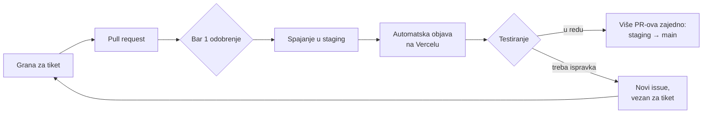

# Kako radimo na projektu

Na Kuki i Motici sada radi više ljudi, pa je teže pratiti šta je spojeno i šta je spremno za objavu. Zato svaka izmena prolazi isti put: pregled koda, grana `staging`, testiranje, pa tek onda `main`.

## Pravila

### 1. Svaki PR traži bar jedno odobrenje

PR se ne spaja dok ga bar jedna osoba ne pregleda i ne odobri (**Approve**).

### 2. Odobren PR se spaja u `staging`

Ciljna grana svakog PR-a je `staging`, ne `main`.

### 3. Izmene se testiraju na stagingu

Staging se objavljuje na **Vercelu**, automatski posle svakog spajanja u `staging`; ništa ne treba pokretati ručno. Kada se nova verzija pojavi na Vercelu, Tijana (i svako ko želi da pomogne u testiranju) proverava implementaciju i javlja da li je sve u redu.

Produkcija ostaje na GitHub Pages i objavljuje se sama kada se `staging` spoji u `main`. Cloud Functions, ekstenzija za e-poštu i Firestore/Storage pravila se i dalje objavljuju ručno (vidi [README → Obaveštenja e-poštom](README.md#obaveštenja-e-poštom)).

### 4. Na `main` ide više PR-ova odjednom

Ne objavljujemo svaki PR posebno. Kada se na stagingu skupi više proverenih PR-ova, `staging` se spaja u `main`. Tako se sve testira na stagingu, a na `main` stiže samo ono što je potvrđeno.

### 5. Ispravka za nešto što je već na stagingu ide kroz novi issue

Ako nešto što je već na stagingu treba popraviti, otvara se **novi issue**. U njemu, u komentaru ili u opisu PR-a jasno se navede na koji se tiket ispravka odnosi (na primer „Ispravka za #44“).

### 6. Release Notes

Uvodimo Release Notes: spisak tiketa koji su ušli u svaku objavu. Tako i mi i svi ostali lako vidimo šta je prošlo.

## Ukratko, za svaki PR

- [ ] PR je otvoren ka grani `staging`.
- [ ] Ima bar jedno odobrenje pre spajanja.
- [ ] Posle objave na staging, tester je potvrdio da radi.
- [ ] Ako je ovo ispravka, u issue-u ili PR-u piše na koji se tiket odnosi.
