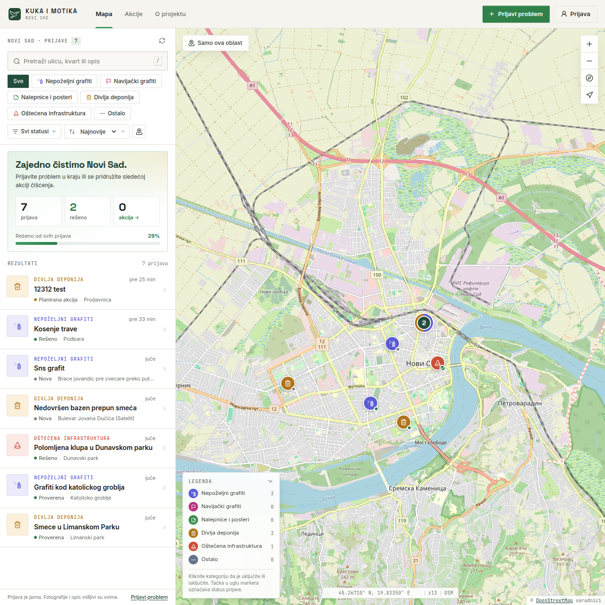
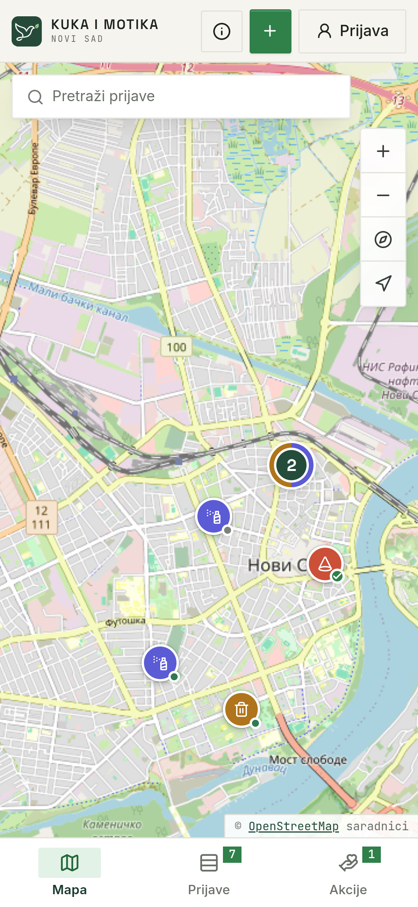

# Kuka i Motika

**Mapa problema u javnim prostorima Novog Sada i mesto za organizovanje zajedničkih akcija čišćenja i uređenja grada.**

Kuka i Motika je zamišljen kao praktičan alat za građane koji žele da prijave smeće, oštećen javni inventar, grafite i druge probleme u svom okruženju. Cilj je da se takvi problemi lakše uoče, dokumentuju i povežu sa ljudima koji žele da pomognu u njihovom rešavanju.

Ideja projekta je jednostavna: umesto da informacije o zapuštenim mestima ostanu rasute po porukama i društvenim mrežama, sve prijave mogu da budu pregledno prikazane na jednoj mapi. Tako zajednica lakše može da proceni gde je pomoć potrebna i da organizuje konkretnu akciju.

## Sadržaj

- [Pregled aplikacije](#pregled-aplikacije)
- [Kako funkcioniše](#kako-funkcioniše)
- [Kategorije problema](#kategorije-problema)
- [Statusi prijava i akcija](#statusi-prijava-i-akcija)
- [Uloga zajednice i moderacija](#uloga-zajednice-i-moderacija)
- [Pristupačnost i korišćenje na različitim uređajima](#pristupačnost-i-korišćenje-na-različitim-uređajima)
- [Trenutno stanje i ograničenja](#trenutno-stanje-i-ograničenja)
- [Tehnička dokumentacija](#tehnička-dokumentacija)
- [Zašto ovaj projekat postoji](#zašto-ovaj-projekat-postoji)
- [Licenca i zahvalnice](#licenca-i-zahvalnice)

## Pregled aplikacije



<p align="center">
  
</p>

> **Napomena:** Prikazi iznad predstavljaju demonstracioni režim aplikacije. Primeri prijava služe za prikaz izgleda i funkcionalnosti i ne predstavljaju stvarno stanje na terenu.

## Kako funkcioniše

### 1. Pregled mape

Glavni deo aplikacije je interaktivna mapa Novog Sada (OpenStreetMap podloga). Na njoj se nalaze oznake koje prikazuju prijavljene probleme i planirane akcije čišćenja. Korisnici mogu da pomeraju mapu, zumiraju određeno područje i otvore pojedinačnu prijavu izborom oznake ili stavke iz liste.

- **Grupisanje oznaka** — kada je na jednom mestu mnogo prijava, oznake se spajaju u grupu sa brojem prijava; klik na grupu približava mapu.
- **Pregled pri prelasku mišem** — oznaka prikazuje kategoriju, naslov i, ako postoji, sličicu fotografije.
- **Legenda** — na desktop prikazu legenda prikazuje broj prijava po kategoriji i omogućava da se pojedine kategorije uključe ili isključe direktno sa mape.
- **Kontrole mape** — zumiranje, povratak na prikaz celog grada i „Moja lokacija“.

Mapa i lista prijava rade zajedno: izbor prijave u listi usmerava mapu na njenu lokaciju, dok izbor oznake na mapi otvara detalje odgovarajuće prijave.

Na vrhu liste nalazi se kratak pregled napretka zajednice: ukupan broj prijava, broj rešenih, udeo rešenih prijava i broj predstojećih akcija.

### 2. Prijavljivanje problema

Korisnik bira lokaciju na mapi (ili koristi svoju trenutnu lokaciju) i popunjava prijavu. Ona može da sadrži:

- naslov (5–90 znakova) i opis problema (20–1200 znakova);
- kategoriju;
- lokaciju označenu na mapi, unutar područja Novog Sada;
- adresu ili orijentir, opciono;
- do tri fotografije (JPG, PNG ili WebP, najviše 5 MB po fotografiji), kada je funkcija za slanje fotografija podešena.

Pre slanja, korisnik može da proveri podatke i prilagodi lokaciju oznake. Aplikacija proverava obavezna polja, prikazuje napredak otpremanja fotografija i poruku o uspešnom slanju ili objašnjenje greške. Ako korisnik zatvori formu sa unetim podacima, aplikacija traži potvrdu pre odbacivanja.

### 3. Pronalaženje relevantnih prijava

Prijave se mogu pretraživati (po naslovu, opisu, adresi, kategoriji i statusu, bez obzira na dijakritike), filtrirati i sortirati:

- filter po jednoj ili više kategorija i statusa;
- sortiranje: najnovije, najstarije, najbliže ili po statusu;
- prikaz samo onih prijava koje su na vidljivom delu mape;
- dugme „Očisti“ za brzo uklanjanje svih filtera.

Taster `/` prebacuje fokus na polje za pretragu. Prijave se učitavaju u delovima, a dugme „Učitaj još prijava“ donosi sledeći deo kada broj prijava poraste.

### 4. Detalji i praćenje statusa

Svaka prijava ima prikaz sa opisom, fotografijama (sa uvećanim prikazom), lokacijom i trenutnim statusom. Lokaciju je moguće otvoriti i na OpenStreetMap mapi, a koordinate kopirati radi lakšeg deljenja. Ako je prijava uključena u akciju čišćenja, detalji prikazuju i povezanu akciju.

Statusi pomažu da se razlikuje tek prijavljen problem od potvrđenog problema ili onog koji je već uključen u plan akcije.

### 5. Organizovanje akcija

Aplikacija sadrži poseban prikaz za akcije čišćenja, podeljen na **predstojeće** i **završene**. Svaka akcija može da prikaže:

- naziv i opis;
- datum i vreme;
- mesto okupljanja, sa oznakom na mapi;
- potrebnu opremu i potrepštine;
- podatke o organizatoru i njegovu napomenu;
- povezane prijave koje se tokom akcije mogu rešavati.

Povezivanje više prijava sa jednom akcijom olakšava planiranje rada na nekoliko problema u istom delu grada.

## Kategorije problema

Prijave su grupisane prema vrsti problema:

| Kategorija | Primeri |
|---|---|
| **Nepoželjni grafiti** | Šaranje, tagovi i uvredljive poruke na fasadama i javnim površinama |
| **Navijački grafiti** | Navijački natpisi, simboli i poruke |
| **Nalepnice i posteri** | Nalepnice, plakati i oglasi zalepljeni na javnim površinama |
| **Divlja deponija** | Nelegalno odložen otpad, građevinski šut i krupno smeće |
| **Oštećena infrastruktura** | Polomljene klupe, staze, igrališta i drugi javni inventar |
| **Ostalo** | Drugi vidljivi problemi u javnom prostoru |

## Statusi prijava i akcija

### Prijave

- **Nova** — prijava je poslata i čeka pregled.
- **Proverena** — problem je potvrđen na terenu.
- **Planirana akcija** — prijava je uključena u planirano čišćenje.
- **U toku** — radovi ili akcija su počeli.
- **Rešeno** — problem je uklonjen.
- **Nije za akciju** — problem nije pogodan za volontersko čišćenje i potrebna je druga vrsta intervencije.

Sama prijava ne znači da je problem zvanično potvrđen, niti da je nadležna služba obaveštena.

### Akcije

- **Planirano**, **U toku**, **Završeno** i **Otkazano**.

## Uloga zajednice i moderacija

Prijave i akcije može da pregleda svako, bez naloga. Za slanje prijave i prijavljivanje neprikladnog sadržaja potrebno je prijavljivanje Google nalogom (kada je aplikacija povezana sa Firebaseom). Uz prijavu se javno prikazuje ime iz naloga, ali ne i adresa e-pošte.

Svaki prijavljeni korisnik može da označi prijavu kao sporan sadržaj, jednom po prijavi, uz jedan od razloga: spam ili reklama, dupla prijava, netačna ili obmanjujuća prijava, neprimeren sadržaj ili drugo.

Administratori u panelu „Administracija“ mogu da:

- menjaju statuse prijava;
- pregledaju označen sadržaj i odbace ga ili zatvore kao rešen;
- kreiraju, uređuju i otkazuju akcije čišćenja i povezuju ih sa prijavama.

Time se smanjuje mogućnost da neprimeren sadržaj ili netačne prijave ostanu bez reakcije. Ova pravila nisu samo u interfejsu — sprovode ih Firestore Security Rules (vidi [Bezbednost i pravila pristupa](#bezbednost-i-pravila-pristupa)).

Korisnici treba da objavljuju samo informacije relevantne za problem na javnom prostoru. Fotografije i opisi ne treba nepotrebno da otkrivaju lične podatke ili prikazuju ljude na način koji ugrožava njihovu privatnost.

## Pristupačnost i korišćenje na različitim uređajima

Interfejs je na srpskom jeziku, latinicom, i prilagođava se desktop računarima, tabletima i mobilnim telefonima. Na manjim ekranima donja navigacija (Mapa, Prijave, Akcije) omogućava brz prelazak između prikaza, dok se detalji i forma za prijavu prikazuju u panelima prilagođenim mobilnom uređaju.

Dizajn je usmeren na preglednost i brzo korišćenje: mapa ostaje u prvom planu, kontrole su jasno grupisane, a boje i ikonice pomažu u razlikovanju kategorija i statusa. Kontrole imaju opisne oznake za čitače ekrana, a dijalozi i paneli se mogu zatvoriti tasterom `Esc`.

## Trenutno stanje i ograničenja

- Aplikacija sadrži demonstracioni režim sa primerima prijava i akcija. On se uključuje automatski kada Firebase nije podešen.
- U demonstracionom režimu nove prijave čuvaju se samo u lokalnom pregledaču (`localStorage`). Ne dele se sa drugim korisnicima i nisu trajno sačuvane u zajedničkoj bazi.
- Pravo zajedničko čuvanje prijava i prijavljivanje korisnika zahtevaju povezivanje aplikacije sa Firebase projektom.
- Slanje fotografija je opciono i dostupno je tek kada je podešen servis za slike (Cloudinary). Bez njega se prijave šalju bez fotografija.
- Aplikacija trenutno nema komentare, obaveštenja putem e-pošte ni evidenciju prisustva volontera.
- Pretraga adresa nije automatska; korisnik označava lokaciju na mapi i, po potrebi, unosi adresu kao tekst.
- Promene se ne osvežavaju automatski u realnom vremenu; podaci se osvežavaju nakon relevantnih radnji ili dugmetom za osvežavanje.
- Prijave i akcije moraju biti unutar područja Novog Sada (približno 45.05–45.45° S, 19.55–20.05° I).

## Tehnička dokumentacija

### Tehnologije

| Oblast | Alat |
|---|---|
| Interfejs | [React 19](https://react.dev/) + [TypeScript](https://www.typescriptlang.org/) |
| Build | [Vite](https://vite.dev/) |
| Mapa | [Leaflet](https://leafletjs.com/), [React Leaflet](https://react-leaflet.js.org/), [Supercluster](https://github.com/mapbox/supercluster), OpenStreetMap pločice |
| Baza i prijava | [Firebase](https://firebase.google.com/) — Cloud Firestore i Authentication (Google) |
| Fotografije | [Cloudinary](https://cloudinary.com/) (unsigned upload), opciono |
| Ikonice | [Lucide](https://lucide.dev/) |
| Hosting | GitHub Pages, preko GitHub Actions |

Aplikacija je potpuno statička i nema sopstveni server. Napravljena je tako da radi na besplatnom Firebase **Spark** planu.

### Struktura projekta

```text
.
├── .github/workflows/deploy.yml   # Build i objava na GitHub Pages
├── docs/                          # Slike za README
├── public/                        # Favicon i znak brenda
├── src/
│   ├── App.tsx                    # Raspored aplikacije
│   ├── config.ts                  # Naziv, granice grada, kategorije, statusi, limiti
│   ├── types.ts                   # Zajednički TypeScript tipovi
│   ├── components/                # UI komponente (mapa, lista, detalji, forme)
│   │   ├── admin/                 # Administracija: akcije i označen sadržaj
│   │   ├── map/                   # Oznake prijava i akcija, ikonice
│   │   ├── modals/                # Dijalozi (prijava, info, lightbox…)
│   │   └── ui/                    # Sitne komponente (bedževi, glifovi)
│   ├── demo/                      # Primeri podataka i lokalno čuvanje za demo režim
│   ├── hooks/                     # useReports, useActions, useAuth, useMediaQuery
│   ├── lib/                       # Formatiranje, geo pomoćne funkcije, timeout
│   ├── services/                  # Firebase, prijave, akcije, oznake, slike, profil
│   ├── state/                     # Globalno stanje aplikacije (AppProvider)
│   └── styles/                    # CSS: tokeni, raspored, mapa, modali, responsive
├── firestore.rules                # Firestore Security Rules
├── firebase.json                  # Firebase CLI konfiguracija (pravila, emulatori)
├── .env.example                   # Primer promenljivih okruženja
└── .firebaserc.example            # Primer Firebase CLI projekta
```

Naziv aplikacije, centar i granice mape, kategorije, statusi, razlozi za označavanje i ograničenja polja definisani su na jednom mestu, u [src/config.ts](src/config.ts).

### Pokretanje lokalno

Potreban je **Node.js 22** ili noviji (verzija je zapisana u `.nvmrc`).

```bash
npm install
npm run dev
```

Aplikacija je dostupna na `http://localhost:5173`. Bez `.env.local` fajla radi u demonstracionom režimu, pa za razvoj interfejsa nije potreban Firebase.

| Komanda | Opis |
|---|---|
| `npm run dev` | Razvojni server sa automatskim osvežavanjem |
| `npm run build` | Provera tipova i produkcioni build u `dist/` |
| `npm run typecheck` | Samo provera TypeScript tipova |
| `npm run preview` | Lokalni pregled produkcionog builda |

### Promenljive okruženja

Kopirajte `.env.example` u `.env.local` i popunite vrednosti. Fajl `.env.local` je u `.gitignore` i ne sme da se commit-uje.

| Promenljiva | Obavezna | Opis |
|---|---|---|
| `VITE_FIREBASE_API_KEY` | za Firebase | Web konfiguracija Firebase aplikacije |
| `VITE_FIREBASE_AUTH_DOMAIN` | za Firebase | npr. `vas-projekat.firebaseapp.com` |
| `VITE_FIREBASE_PROJECT_ID` | za Firebase | ID Firebase projekta |
| `VITE_FIREBASE_STORAGE_BUCKET` | ne | Deo standardne konfiguracije; aplikacija ne koristi Firebase Storage |
| `VITE_FIREBASE_MESSAGING_SENDER_ID` | ne | Deo standardne konfiguracije |
| `VITE_FIREBASE_APP_ID` | za Firebase | ID web aplikacije |
| `VITE_IMAGE_PROVIDER` | ne | `cloudinary` ili prazno (fotografije isključene) |
| `VITE_CLOUDINARY_CLOUD_NAME` | za fotografije | Cloudinary cloud name |
| `VITE_CLOUDINARY_UPLOAD_PRESET` | za fotografije | Naziv **unsigned** upload preseta |
| `VITE_CLOUDINARY_FOLDER` | ne | Folder za otpremljene slike (podrazumevano `ns-cisto`) |
| `VITE_BASE_PATH` | ne | Osnovna putanja builda; lokalno ostaje prazno (`/`) |

Firebase je uključen samo kada su postavljeni `API_KEY`, `AUTH_DOMAIN`, `PROJECT_ID` i `APP_ID`; u suprotnom aplikacija jasno prikazuje demo režim. Ako `VITE_IMAGE_PROVIDER` nije postavljen, a postoje Cloudinary cloud name i upload preset, Cloudinary se uključuje automatski.

> Sve `VITE_` promenljive završavaju u javnom JavaScript buildu. Firebase web konfiguracija **nije tajna** — pristup podacima štite Firestore Security Rules, a ne skrivanje ključeva. U ove promenljive nikada ne stavljajte serverske tajne (npr. Cloudinary API secret).

### Podešavanje Firebasea

1. U [Firebase konzoli](https://console.firebase.google.com/) napravite projekat (Spark plan je dovoljan).
2. Dodajte **Web aplikaciju** i prepišite njenu konfiguraciju u `.env.local`.
3. **Authentication → Sign-in method**: uključite **Google**.
4. **Authentication → Settings → Authorized domains**: dodajte domen na kome je sajt objavljen (npr. `ocistimo-novi-sad.github.io`); `localhost` je već na listi.
5. **Firestore Database**: napravite bazu u produkcionom režimu.
6. Objavite pravila pristupa pomoću [Firebase CLI](https://firebase.google.com/docs/cli):

   ```bash
   npm install -g firebase-tools
   firebase login
   cp .firebaserc.example .firebaserc   # upišite ID svog projekta
   firebase deploy --only firestore:rules
   ```

7. **Dodavanje administratora**: prijavite se jednom u aplikaciju, u konzoli (**Authentication → Users**) kopirajte svoj UID i u Firestore-u napravite dokument `admins/{UID}` (sadržaj može biti prazan ili npr. `{ "note": "ime" }`). Kolekciju `admins` nije moguće menjati iz aplikacije — samo iz konzole ili preko Admin SDK-a. Posle osvežavanja stranice pojavljuje se meni „Administracija“.

Upiti koriste samo indekse po jednom polju, koje Firestore pravi automatski, pa dodatni kompozitni indeksi nisu potrebni.

`firebase.json` definiše i lokalne emulatore za Auth i Firestore (`firebase emulators:start`), korisne za proveru pravila. Aplikacija se trenutno ne povezuje automatski na emulatore.

### Podešavanje fotografija (Cloudinary)

Firebase Storage za projekte napravljene posle 30. oktobra 2024. zahteva plaćeni Blaze plan, zato aplikacija fotografije otprema na Cloudinary direktno iz pregledača.

1. Napravite besplatan Cloudinary nalog.
2. **Settings → Upload → Upload presets**: dodajte preset sa režimom **Unsigned**. Preporučeno je ograničiti dozvoljene formate (`jpg, png, webp`) i maksimalnu veličinu fajla.
3. Upišite `VITE_IMAGE_PROVIDER=cloudinary`, cloud name i naziv preseta u `.env.local`.

Prikaz fotografija automatski dodaje Cloudinary transformacije (`f_auto,q_auto`, ograničena širina) radi bržeg učitavanja. Drugi servis za slike može se dodati implementacijom interfejsa `ImageStorage` u [src/services/images.ts](src/services/images.ts).

### Objavljivanje (GitHub Pages)

Workflow [.github/workflows/deploy.yml](.github/workflows/deploy.yml) se pokreće na svaki push na granu `main` (ili ručno, preko **Actions → Run workflow**). On instalira zavisnosti, pravi build i objavljuje `dist/` na GitHub Pages.

Jednokratno podešavanje repozitorijuma:

1. **Settings → Pages → Source**: izaberite **GitHub Actions**.
2. **Settings → Secrets and variables → Actions → Variables**: dodajte `VITE_FIREBASE_*` i, po potrebi, `VITE_IMAGE_PROVIDER` i `VITE_CLOUDINARY_*` vrednosti. Koriste se **Variables**, ne Secrets, jer su ove vrednosti ionako javne u buildu.

Osnovnu putanju workflow određuje sam: za repozitorijum `<vlasnik>.github.io` (kao što je ovaj) build se pravi za `/`, a za ostale repozitorijume za `/<naziv-repozitorijuma>/`. Ako Firebase promenljive nisu postavljene, objavljeni sajt radi u demo režimu.

### Model podataka (Firestore)

| Kolekcija | Sadržaj | Čitanje | Pisanje |
|---|---|---|---|
| `reports` | Prijave: naslov, opis, kategorija, status, koordinate, adresa, URL-ovi fotografija, autor, vreme | svi | prijavljeni korisnik kreira (uvek sa statusom `new`); administrator menja status (pravila dozvoljavaju i brisanje, ali ono trenutno nije dostupno u interfejsu) |
| `actions` | Akcije: naziv, opis, datum, mesto okupljanja, koordinate, status, povezane prijave, oprema, organizator | svi | samo administratori |
| `flags` | Označen sadržaj: prijava, razlog, napomena, status (`open` / `dismissed` / `resolved`) | administratori | prijavljeni korisnik kreira jednu oznaku po prijavi (ID `{uid}__{reportId}`); administratori obrađuju |
| `users` | Minimalan profil: ime, fotografija naloga, vreme | vlasnik | vlasnik |
| `admins` | Lista administratora (ID dokumenta = UID) | vlasnik sopstvenog dokumenta | samo konzola / Admin SDK |

Prijave se učitavaju sortirane po vremenu kreiranja, po 80 u jednom zahtevu; akcije se učitavaju do 80 najnovijih. Firestore koristi lokalni keš u IndexedDB-u (sa rezervom u memoriji, npr. u privatnom režimu pregledača). Stari ID-jevi kategorija (`graffiti`, `waste`, `neglected_area`) automatski se prikazuju kao odgovarajuće nove kategorije.

### Bezbednost i pravila pristupa

[firestore.rules](firestore.rules) je stvarna granica pristupa; provere u interfejsu služe samo za bolje korisničko iskustvo. Pravila, između ostalog:

- dozvoljavaju samo poznata polja i proveravaju dužinu teksta, kategoriju, status i broj fotografija (najviše 3);
- prihvataju koordinate samo unutar područja Novog Sada;
- zahtevaju da `createdAt` bude serversko vreme, a `createdBy` UID prijavljenog korisnika;
- dozvoljavaju administratorima da kod prijava menjaju samo status, uz obavezno beleženje ko je i kada izvršio izmenu;
- zatvaraju sve kolekcije koje nisu izričito navedene.

Posle svake izmene pravila ponovo pokrenite `firebase deploy --only firestore:rules`.

### Promena naziva ili grada

Naziv aplikacije, natpis brenda, grad, centar mape, početni zum i granice područja nalaze se u objektu `APP` u [src/config.ts](src/config.ts). Granice područja su zapisane i u funkciji `validCoordinates` u [firestore.rules](firestore.rules) i moraju se menjati na oba mesta. Naslov stranice je u [index.html](index.html).

## Zašto ovaj projekat postoji

Čistiji i uređeniji grad ne zavisi samo od toga da li neko primeti problem, već i od toga da li drugi mogu da saznaju za njega i da li postoji način da se organizuju oko rešenja.

Kuka i Motika nastoji da poveže tri koraka na jednom mestu: **uočavanje problema, njegovo dokumentovanje i organizovanje zajedničke akcije**. Cilj je da se ljudima olakša da pređu sa opažanja problema na konkretnu pomoć svom naselju i gradu.

## Licenca i zahvalnice

Projekat je objavljen kao javno dobro pod licencom [The Unlicense](LICENSE).

- Kartografski podaci i podloga mape: [OpenStreetMap contributors](https://www.openstreetmap.org/copyright).
- Ikonice: [Lucide](https://lucide.dev/).
- Primeri prijava i akcija u demonstracionom režimu su izmišljeni i ne opisuju stvarno trenutno stanje u Novom Sadu.
