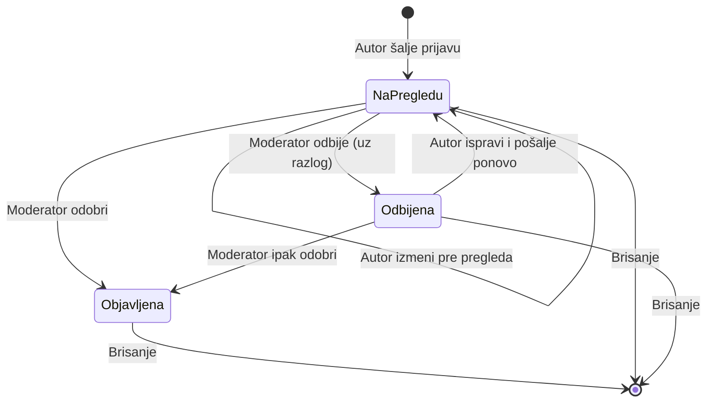
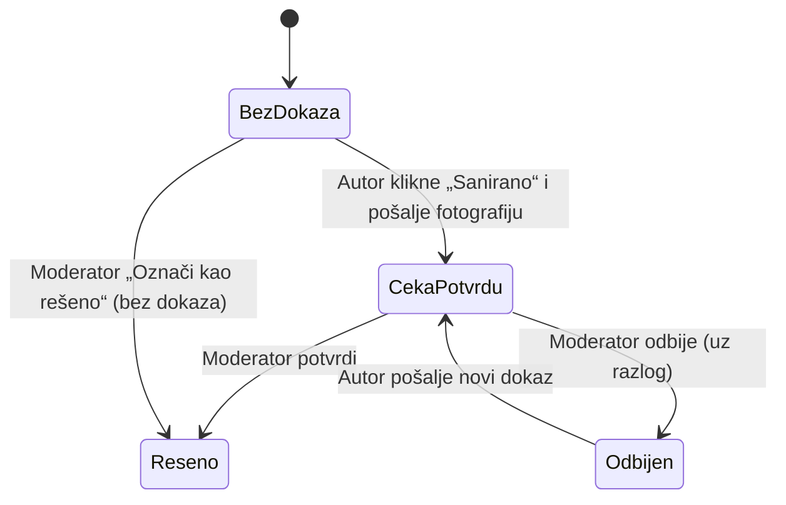
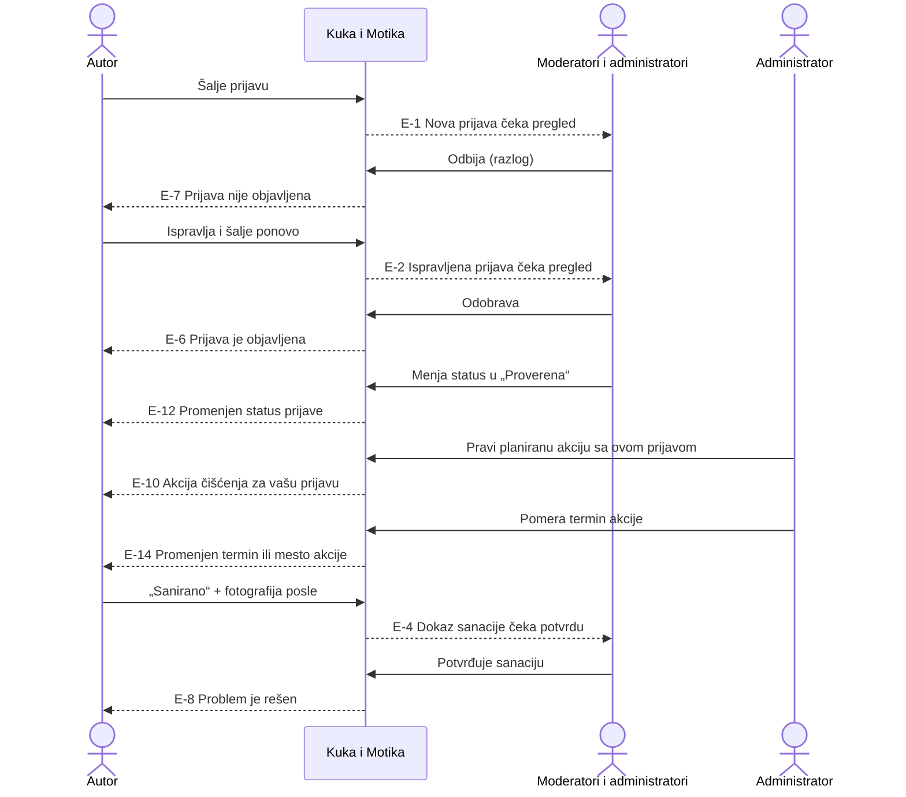

# Kuka i Motika — kako aplikacija radi

Ovaj dokument opisuje aplikaciju iz ugla korisnika: koje uloge postoje, šta svaka uloga može da radi i gde se to nalazi, kroz koje stanje prolazi prijava i kada aplikacija kome šalje e-poštu. Tehnički detalji (biblioteke, baza, objavljivanje) nisu deo ovog dokumenta.

## Sadržaj

1. [Ukratko](#1-ukratko)
2. [Uloge](#2-uloge)
3. [Gde se šta nalazi](#3-gde-se-šta-nalazi)
4. [Životni ciklus prijave](#4-životni-ciklus-prijave)
5. [Životni ciklus akcije](#5-životni-ciklus-akcije)
6. [Slučajevi korišćenja — posetilac](#6-slučajevi-korišćenja--posetilac)
7. [Slučajevi korišćenja — član zajednice](#7-slučajevi-korišćenja--član-zajednice)
8. [Slučajevi korišćenja — moderator](#8-slučajevi-korišćenja--moderator)
9. [Slučajevi korišćenja — administrator](#9-slučajevi-korišćenja--administrator)
10. [Obaveštenja e-poštom](#10-obaveštenja-e-poštom)
11. [Pravila unosa i ograničenja](#11-pravila-unosa-i-ograničenja)
12. [Demo režim](#12-demo-režim)

---

## 1. Ukratko

Kuka i Motika je mapa problema u javnim prostorima Novog Sada (smeće, grafiti, nalepnice, divlje deponije, oštećen javni inventar) i mesto za organizovanje akcija čišćenja.

Osnovni tok:

1. Građanin prijavi problem na mapi, sa opisom i fotografijama.
2. Moderator pregleda prijavu i objavi je, ili je odbije uz razlog.
3. Objavljena prijava je vidljiva svima na mapi.
4. Administrator organizuje akciju čišćenja i poveže je sa prijavama.
5. Kada je problem rešen, autor pošalje fotografiju „posle“, a moderator potvrdi da je rešeno.

Kroz ceo tok aplikacija šalje kratka obaveštenja e-poštom onima kojih se promena tiče.

---

## 2. Uloge

Aplikacija ima četiri nivoa pristupa. Svaki viši nivo ima sva prava nižih.

| Uloga | Ko je to | Kako se dobija |
|---|---|---|
| **Posetilac** | Bilo ko ko otvori sajt, bez prijave | Nije potrebno ništa |
| **Član zajednice** | Korisnik prijavljen Google nalogom | Klikom na „Prijava“ i izborom Google naloga. Registracija ne postoji. |
| **Moderator** | Član koji pregleda i uređuje prijave | Dodeljuje ga administrator u aplikaciji (Administracija → Korisnici i uloge) |
| **Administrator** | Moderator koji uz to upravlja akcijama i ulogama | Dodeljuje ga samo vlasnik projekta, van aplikacije. Iz aplikacije se ne može dodeliti ni oduzeti. |

### 2.1 Šta koja uloga može

| Radnja | Posetilac | Član | Moderator | Administrator |
|---|:-:|:-:|:-:|:-:|
| Pregled mape, objavljenih prijava i akcija | ✓ | ✓ | ✓ | ✓ |
| Pretraga, filteri, sortiranje, deljenje linka prijave | ✓ | ✓ | ✓ | ✓ |
| Slanje nove prijave | — | ✓ | ✓ | ✓ |
| „Moje prijave“: praćenje, izmena i brisanje sopstvenih prijava | — | ✓ | ✓ | ✓ |
| Slanje dokaza sanacije za sopstvenu prijavu | — | ✓ | ✓ | ✓ |
| Prijava spornog sadržaja | — | ✓ | ✓ | ✓ |
| Pregled neobjavljenih prijava drugih korisnika | — | — | ✓ | ✓ |
| Odobravanje i odbijanje novih prijava | — | — | ✓ | ✓ |
| Pregled izmena objavljenih prijava (prihvati / vrati) | — | — | ✓ | ✓ |
| Potvrda ili odbijanje dokaza sanacije, „Označi kao rešeno“ | — | — | ✓ | ✓ |
| Promena statusa prijave | — | — | ✓ | ✓ |
| Izmena i brisanje bilo čije prijave | — | — | ✓ | ✓ |
| Obrada označenog (spornog) sadržaja | — | — | ✓ | ✓ |
| Kreiranje, uređivanje i otkazivanje akcija čišćenja | — | — | — | ✓ |
| Spisak korisnika, dodela i oduzimanje uloge moderatora | — | — | — | ✓ |

### 2.2 Važne napomene o ulogama

- **Uloga se proverava pri prijavi i pri učitavanju stranice.** Ako administrator nekome dodeli ili oduzme ulogu moderatora, ta osoba novi meni vidi kada ponovo učita stranicu. Oduzeta prava prestaju da rade odmah, čak i ako je stari meni još na ekranu.
- **Administrator je u spisku korisnika zaključan** (ikonica katanca). Ne može mu se promeniti uloga iz aplikacije.
- **Moderatori ne vide spisak korisnika** niti tuđe adrese e-pošte.
- **Javno se prikazuje samo ime** iz Google naloga uz prijavu. Adresa e-pošte se nikada ne prikazuje javno; vide je samo vlasnik naloga i administratori.
- **Moderator i administrator nisu iznad pravila za sopstvene prijave**: i njihova nova prijava ide na pregled. Mogu je, međutim, sami odobriti.

---

## 3. Gde se šta nalazi

### 3.1 Zaglavlje (vrh ekrana)

| Element | Šta radi |
|---|---|
| **Mapa** | Prikaz mape sa prijavama i liste prijava |
| **Akcije** | Prikaz akcija čišćenja (predstojeće i završene) |
| **O projektu** | Kratko objašnjenje projekta, kako se koristi i napomena o privatnosti |
| **Demo** (oznaka) | Vidi se samo u demo režimu; otvara objašnjenje |
| **Prijavi problem** | Otvara formu za novu prijavu (traži prijavu nalogom ako korisnik nije prijavljen) |
| **Prijava** / avatar | Neprijavljenom: dugme „Prijava“. Prijavljenom: avatar koji otvara meni naloga |

### 3.2 Meni naloga (klik na avatar)

| Stavka | Ko je vidi | Šta otvara |
|---|---|---|
| Ime, e-pošta, oznaka uloge | Svi prijavljeni (oznaka samo za moderatora/administratora) | — |
| **Moje prijave** | Svi prijavljeni | Lista sopstvenih prijava i njihovog stanja. Crveni broj = prijave koje treba ispraviti. |
| **Moderacija** | Moderator, administrator | Redovi za pregled: Nove prijave, Izmene, Sanacije, Označen sadržaj. Broj = ukupno stavki koje čekaju. |
| **Administracija** | Administrator | Akcije čišćenja; Korisnici i uloge |
| **Odjava** | Svi prijavljeni | Odjava sa naloga |

Na avataru se pojavljuje **crvena tačka** kada nešto čeka korisnika: odbijena prijava ili odbijen dokaz sanacije koji treba ispraviti, a za moderatore i stavke u redovima moderacije.

### 3.3 Glavni ekran

- **Mapa** — oznake prijava (boja i ikonica po kategoriji), grupisanje oznaka kada ih je mnogo na jednom mestu, legenda sa brojem prijava po kategoriji (može da uključi/isključi kategoriju), kontrole za zumiranje, „Prikaži ceo Novi Sad“ i „Moja lokacija“.
- **Lista prijava** (levo na računaru, tab „Prijave“ na telefonu) — sažetak napretka (ukupno, rešeno, udeo rešenih, predstojeće akcije), pretraga, filteri, sortiranje i lista.
- **Panel sa detaljima** (desno na računaru, donji list na telefonu) — detalji prijave, detalji akcije ili forma za prijavu.

### 3.4 Mobilni telefon

Na dnu ekrana je traka sa tri taba: **Mapa**, **Prijave**, **Akcije**. Detalji i forme se otvaraju kao list koji se izvlači odozdo.

---

## 4. Životni ciklus prijave

Prijava ima tri nezavisne „ose“ stanja.

### 4.1 Vidljivost (moderacija)

| Stanje | Oznaka u aplikaciji | Ko vidi prijavu |
|---|---|---|
| Na pregledu | „Na pregledu“ | Samo autor i moderatori |
| Objavljena | „Objavljena“ / status prijave | Svi |
| Odbijena | „Odbijena“ + razlog | Samo autor i moderatori |

### 4.2 Status (samo za objavljene prijave)

Status opisuje stanje problema na terenu. Menja ga moderator ručno; jedini automatski prelaz je u „Rešeno“ kada moderator potvrdi dokaz sanacije ili klikne „Označi kao rešeno“.

| Status | Značenje |
|---|---|
| **Nova** | Objavljena, još bez plana akcije |
| **Proverena** | Problem je potvrđen na terenu |
| **Planirana akcija** | Prijava je uključena u planirano čišćenje |
| **U toku** | Radovi ili akcija su počeli |
| **Rešeno** | Problem je uklonjen |
| **Nije za akciju** | Problem nije pogodan za volontersko čišćenje |

> Povezivanje prijave sa akcijom **ne menja** status prijave automatski. Moderator status menja posebno.

### 4.3 Izmena objavljene prijave

Kada autor izmeni već objavljenu prijavu:

- izmena je **odmah javno vidljiva**;
- prijava dobija oznaku „Izmena čeka pregled“;
- poslednja odobrena verzija se čuva dok moderator ne odluči;
- moderator može da **prihvati izmenu** ili da **vrati prethodnu verziju**.

Ako autor izmeni prijavu više puta pre nego što moderator pogleda, čuva se i dalje ona prvobitno odobrena verzija.

### 4.4 Sanacija (dokaz da je problem rešen)

Kada je prijava rešena uz dokaz, u detaljima se prikazuje poređenje **„Pre i posle“** i napomena autora.

---

## 5. Životni ciklus akcije

| Status | Značenje | Gde se prikazuje |
|---|---|---|
| **Planirano** | Termin je zakazan | „Predstojeće“ |
| **U toku** | Akcija traje | „Predstojeće“ |
| **Završeno** | Akcija je održana | „Završene“ |
| **Otkazano** | Akcija neće biti održana | „Završene“ |

Akcija sa statusom „Planirano“ ili „U toku“ prelazi u „Završene“ i kada prođe više od 4 sata od zakazanog vremena, čak i ako joj administrator nije promenio status.

Akcije menja samo administrator; status može da postavi na bilo koju vrednost u formi za uređivanje.

---

## 6. Slučajevi korišćenja — posetilac

### UC-01 Pregled mape i prijava

- **Akter:** svako
- **Gde:** Mapa (početni ekran)
- **Tok:**
  1. Korisnik otvara sajt; mapa je centrirana na Novi Sad.
  2. Na mapi se vide samo **objavljene** prijave.
  3. Prelazak mišem preko oznake prikazuje kategoriju, naslov i sličicu.
  4. Klik na oznaku ili na stavku u listi otvara detalje prijave i približava mapu.
  5. Klik na grupu oznaka približava to područje.
- **Napomene:** prijave se učitavaju u delovima; dugme „Učitaj još prijava“ donosi sledeće. Podaci se ne osvežavaju sami; za osvežavanje služi ikonica u listi.

### UC-02 Pretraga, filtriranje i sortiranje

- **Akter:** svako
- **Gde:** lista prijava
- **Tok:**
  1. Unos teksta u pretragu (prečica `/`). Traži se po naslovu, opisu, adresi, kategoriji i statusu, bez obzira na kvačice (č, ć, š, ž, đ).
  2. Filter po jednoj ili više kategorija i statusa.
  3. Sortiranje: najnovije, najstarije, najbliže (zahteva „Moja lokacija“), po statusu.
  4. „Samo ova oblast“ na mapi (ili ikonica u filterima) ograničava listu na trenutno vidljivi deo mape.
  5. „Očisti“ uklanja sve filtere.

### UC-03 Detalji prijave i deljenje

- **Akter:** svako
- **Gde:** panel sa detaljima prijave
- **Prikazuje:** kategoriju, status, naslov, autora (ime) i vreme, fotografije (klik = uvećan prikaz), opis, plan („Šta zajednica može sama“, „Za šta nam treba pomoć“), lokaciju i koordinate, povezanu akciju (ako postoji).
- **Radnje:** „OpenStreetMap“, „Kopiraj koordinate“, „Prikaži na mapi“, „Prijavi sadržaj“ (vidi UC-12).
- **Deljenje:** dok je prijava otvorena, adresa u pregledaču sadrži `?prijava=…`. Taj link otvara istu prijavu. Ako prijava nije javna, a korisnik nije njen autor ni moderator, aplikacija javlja „Ova prijava još nije javna. Prijavite se ako ste njen autor.“ Ako je obrisana: „Prijava nije pronađena. Možda je obrisana.“

### UC-04 Pregled akcija čišćenja

- **Akter:** svako
- **Gde:** Akcije (zaglavlje ili tab na telefonu)
- **Tok:**
  1. Lista je podeljena na **Predstojeće** i **Završene**.
  2. Klik na akciju otvara detalje i prikazuje mesto okupljanja na mapi.
  3. Detalji: naslovna fotografija, datum i vreme, opis, mesto okupljanja, organizator i napomena, šta poneti, povezane prijave (klik vodi na prijavu), a za završene i fotografije sa akcije.

### UC-05 Prijava Google nalogom

- **Akter:** posetilac
- **Gde:** dugme „Prijava“, ili automatski kada posetilac pokuša radnju koja zahteva nalog („Prijavi problem“, „Prijavi sadržaj“)
- **Tok:**
  1. Otvara se prozor „Prijavite se da nastavite“ sa objašnjenjem zašto je nalog potreban.
  2. „Nastavi sa Google“ → izbor Google naloga.
  3. Aplikacija čuva ime, profilnu sliku i adresu e-pošte iz Google naloga. Na tu adresu stižu obaveštenja.
  4. Ako je prijava pokrenuta iz neke radnje, ta radnja se nastavlja (otvara se forma za prijavu ili prozor za prijavu sadržaja).
- **Alternativno:** ako pregledač blokira iskačući prozor, prijava se obavlja preusmeravanjem na Google stranicu.

---

## 7. Slučajevi korišćenja — član zajednice

### UC-06 Slanje nove prijave

- **Akter:** prijavljen korisnik
- **Gde:** „Prijavi problem“ u zaglavlju; „Nova prijava“ u praznoj listi „Moje prijave“
- **Preduslov:** korisnik je prijavljen (inače se prvo traži prijava, UC-05)
- **Tok:**
  1. **Lokacija:** korisnik klikne na mapu ili koristi svoju lokaciju. Tačka mora biti u Novom Sadu.
  2. **Detalji:** naslov, kategorija, opis, adresa ili orijentir (opciono).
  3. **Kako možemo da rešimo:** „Šta zajednica može sama“ i „Za šta nam treba pomoć“ — oba obavezna, mogu se popuniti brzim izborom ponuđenih odgovora.
  4. **Fotografije:** do 3, opciono. Aplikacija ih smanjuje i uklanja podatke iz fotografije (uključujući GPS lokaciju telefona) pre slanja.
  5. „Pošalji na pregled“.
- **Rezultat:** ekran „Hvala! Prijava je na pregledu.“ Prijava ima stanje „Na pregledu“ i vide je samo autor i moderatori.
- **E-pošta:** svim moderatorima i administratorima stiže **„Nova prijava čeka pregled“** (vidi [E-1](#101-pregled-svih-obaveštenja)). Autor ne dobija ništa u ovom trenutku.
- **Greške:**
  - nepopunjeno ili prekratko polje → poruka uz polje, fokus na prvo neispravno;
  - lokacija van Novog Sada → „Lokacija mora biti u Novom Sadu.“;
  - fotografija nije otpremljena → prijava se ne šalje, korisnik pokušava ponovo; već otpremljene fotografije se ne šalju ponovo;
  - zatvaranje forme sa unetim podacima → traži se potvrda „Otkaži prijavu“.

### UC-07 Praćenje sopstvenih prijava

- **Akter:** prijavljen korisnik
- **Gde:** meni naloga → **Moje prijave**
- **Tok:**
  1. Lista svih sopstvenih prijava, uključujući neobjavljene.
  2. Filteri: Sve, Na pregledu, Objavljene, Odbijene, Rešene (sa brojem u svakom).
  3. Ako postoji odbijena prijava, panel se otvara na filteru „Odbijene“.
  4. Uz svaku prijavu: stanje, oznake „Izmena čeka pregled“ / „Sanacija čeka potvrdu“, razlog odbijanja ako postoji.
  5. Radnje po prijavi: **Sanirano**, **Izmeni** ili **Ispravi i pošalji ponovo**, **Obriši**.

### UC-08 Ispravka prijave pre objave

- **Akter:** autor
- **Gde:** Moje prijave → „Ispravi i pošalji ponovo“ / „Izmeni“; ili detalji prijave → traka „Vaša prijava“ → „Izmeni“
- **Preduslov:** prijava je „Na pregledu“ ili „Odbijena“
- **Tok:**
  1. Otvara se ista forma, popunjena postojećim podacima.
  2. Autor menja šta treba i klikne „Pošalji ponovo na pregled“.
  3. Prijava se vraća u stanje „Na pregledu“, a stari razlog odbijanja se briše.
- **E-pošta:**
  - ako je prijava bila **odbijena** → moderatorima i administratorima stiže **„Ispravljena prijava čeka pregled“** (E-2);
  - ako je prijava još bila **na pregledu** → **ne šalje se ništa** (moderatori je već imaju u redu).

### UC-09 Izmena objavljene prijave

- **Akter:** autor
- **Gde:** detalji prijave → „Izmeni“; Moje prijave → „Izmeni“
- **Preduslov:** prijava je objavljena
- **Tok:**
  1. Autor menja podatke i klikne „Sačuvaj izmene“.
  2. Izmena je odmah javna. Autor vidi poruku „Vaša izmena je vidljiva svima. Moderator će je pregledati.“
  3. Prijava se pojavljuje u Moderaciji, tab „Izmene“.
- **E-pošta:** moderatorima i administratorima **„Izmena objavljene prijave“** (E-3), ali **samo za prvu izmenu** dok moderator ne odluči. Dalje izmene pre odluke ne šalju novu poruku.

### UC-10 Prijava da je problem rešen (dokaz sanacije)

- **Akter:** autor
- **Gde:** detalji prijave → „Sanirano“; Moje prijave → „Sanirano“
- **Preduslov:** prijava je objavljena, nije rešena, nema dokaz koji već čeka potvrdu, i na sajtu je uključeno slanje fotografija
- **Tok:**
  1. Otvara se „Označi kao sanirano“ sa fotografijom „Pre“ iz prijave.
  2. Autor dodaje 1–3 fotografije „Posle“ (obavezno bar jedna) i opcionu napomenu.
  3. „Pošalji na potvrdu“.
  4. U detaljima piše „Poslali ste dokaz sanacije. Moderator će ga pogledati i potvrditi.“ Drugi korisnici vide „Prijavljena sanacija, čeka potvrdu moderatora.“
- **E-pošta:** moderatorima i administratorima **„Dokaz sanacije čeka potvrdu“** (E-4).
- **Alternativno — dokaz je odbijen:** autor vidi „Sanacija nije potvrđena“ i razlog, i može kliknuti **„Pošalji novi dokaz“**. Novi dokaz zamenjuje stari i ponovo šalje E-4.

### UC-11 Brisanje sopstvene prijave

- **Akter:** autor
- **Gde:** detalji prijave → „Obriši“; Moje prijave → „Obriši“
- **Tok:** „Obriši“ → potvrda „Trajno obrisati?“ → „Obriši“. Prijava i njene fotografije se trajno brišu.
- **E-pošta:** ne šalje se.

### UC-12 Prijava spornog sadržaja

- **Akter:** prijavljen korisnik
- **Gde:** detalji objavljene prijave → dno panela → „Prijavi sadržaj“
- **Tok:**
  1. Izbor razloga: Spam ili reklama; Dupla prijava; Netačna ili obmanjujuća prijava; Neprimeren sadržaj; Drugo.
  2. Opciona napomena.
  3. „Pošalji prijavu“ → „Prijava sadržaja je poslata administratorima.“
- **Ograničenje:** jedan korisnik može istu prijavu da označi **samo jednom**. Drugi pokušaj javlja grešku.
- **E-pošta:** svim moderatorima i administratorima, osim onome ko je označio, **„Prijavljen sporan sadržaj“** (E-5). Autor označene prijave **ne dobija** obaveštenje.

### UC-13 Odjava

- **Gde:** meni naloga → „Odjava“. Posle odjave korisnik vidi samo javni sadržaj.

---

## 8. Slučajevi korišćenja — moderator

Moderator ima sve što i član zajednice, plus stavku **Moderacija** u meniju naloga. Moderacija ima četiri taba; uz svaki stoji broj stavki koje čekaju. Svaka odluka moderatora beleži se uz njegovo ime i vreme (vidljivo moderatorima u dnu detalja: „Odobrio: … · datum“).

### UC-14 Pregled novih prijava

- **Gde:** Moderacija → **Nove prijave** (najstarije prvo); ili detalji neobjavljene prijave → okvir „Moderacija“; ili link iz e-pošte
- **Tok — odobravanje:**
  1. Moderator pregleda prijavu (fotografije, opis, lokacija, „Otvori na mapi“).
  2. „Odobri i objavi“ → prijava odmah postaje javna, sa statusom „Nova“.
  3. **E-pošta:** autoru **„Prijava je objavljena“** (E-6).
- **Tok — odbijanje:**
  1. „Odbij…“ → upis razloga (najmanje 10 znakova) ili izbor čestog razloga:
     - Fotografija ne prikazuje problem.
     - Dupla prijava, problem je već prijavljen.
     - Lokacija nije tačna.
     - Prijava sadrži lične podatke.
     - Problem nije u javnom prostoru.
  2. „Odbij“ → prijava dobija stanje „Odbijena“; autor vidi razlog u aplikaciji.
  3. **E-pošta:** autoru **„Prijava nije objavljena“** sa razlogom (E-7).
- **Već odbijena prijava:** moderator može da je ipak odobri (šalje E-6) ili da **promeni razlog** odbijanja. Promena razloga **ne šalje** novu poruku.

### UC-15 Pregled izmena objavljenih prijava

- **Gde:** Moderacija → **Izmene**; ili detalji prijave → okvir „Izmena autora“
- **Tok:**
  1. Za svako polje koje je izmenjeno prikazuje se „Bilo“ i „Sada“ (tekst, lokacija, fotografije).
  2. **Prihvati izmenu** → izmena ostaje, prethodna verzija se briše.
     **E-pošta:** ne šalje se (izmena je autoru već vidljiva).
  3. **Vrati prethodnu** → vraća se poslednja odobrena verzija.
     **E-pošta:** autoru **„Izmena prijave nije prihvaćena“** (E-13).

### UC-16 Potvrda dokaza sanacije

- **Gde:** Moderacija → **Sanacije** (najstarije prvo); ili detalji prijave → „Sanacija čeka potvrdu“
- **Tok:**
  1. Moderator vidi „Pre i posle“ i napomenu autora.
  2. **Potvrdi sanaciju** → prijava dobija status „Rešeno“, zeleni natpis „Rešeno · hvala zajednici“.
     **E-pošta:** autoru **„Problem je rešen“** (E-8).
  3. **Odbij…** → razlog (najmanje 10 znakova) ili čest razlog:
     - Fotografija ne prikazuje isto mesto.
     - Problem se na fotografiji još vidi.
     - Fotografija nije dovoljno jasna.
     - Rešen je samo deo problema.

     **E-pošta:** autoru **„Dokaz sanacije nije prihvaćen“** sa razlogom (E-9).

### UC-17 Označi kao rešeno bez dokaza

- **Gde:** detalji objavljene, nerešene prijave → „Označi kao rešeno“ → „Rešeno bez dokaza?“ → „Da“
- **Kada:** moderator zna da je problem rešen (npr. sa akcije), a autor nije poslao fotografiju.
- **Preduslov:** nema dokaza koji čeka potvrdu (tada se koristi UC-16).
- **E-pošta:** autoru **„Problem je rešen“** u varijanti „Vaša prijava … je označena kao rešena.“ (E-8).
- **Izuzetak:** ako je prijava već jednom bila rešena, pa joj je status ručno vraćen, ponovno „Označi kao rešeno“ šalje **„Promenjen status prijave“** sa statusom „Rešeno“ (E-12), a ne E-8.

### UC-18 Promena statusa prijave

- **Gde:** detalji objavljene prijave → okvir „Moderacija“ → izbor statusa → „Sačuvaj“
- **Tok:** moderator bira bilo koji od šest statusa (npr. „Proverena“, „Planirana akcija“, „Nije za akciju“).
- **E-pošta:** autoru **„Promenjen status prijave“** sa novim statusom i njegovim značenjem (E-12). Važi za svaki status, uključujući „Rešeno“ izabrano iz liste. Kada prijava postane rešena preko UC-16 ili UC-17, autor umesto toga dobija E-8, ne obe poruke.

### UC-19 Izmena i brisanje bilo koje prijave

- **Gde:** detalji prijave → „Izmeni prijavu“ / „Obriši“
- **Tok — izmena:** ista forma kao za autora; izmena moderatora se primenjuje odmah, beleži se uz njegovo ime i **ne ide na pregled**.
- **Tok — brisanje:** potvrda „Trajno obrisati?“. Sve otvorene oznake spornog sadržaja za tu prijavu automatski se zatvaraju kao rešene.
- **E-pošta:** ne šalje se.

### UC-20 Obrada označenog sadržaja

- **Gde:** Moderacija → **Označen sadržaj**
- **Tok:**
  1. Lista otvorenih oznaka: razlog, koliko je stara, naslov prijave, napomena.
  2. **Otvori prijavu** → detalji, gde moderator po potrebi izmeni ili obriše prijavu (UC-19).
  3. **Rešeno** → oznaka je opravdana i obrađena.
  4. **Odbij** → oznaka nije opravdana.
- **Napomena:** zatvaranje oznake ne menja samu prijavu. Prijavu treba posebno izmeniti ili obrisati.
- **E-pošta:** zatvaranje oznake ne šalje poruku ni onome ko je označio ni autoru.

---

## 9. Slučajevi korišćenja — administrator

Administrator ima sva prava moderatora, plus stavku **Administracija** u meniju naloga (tabovi „Akcije čišćenja“ i „Korisnici i uloge“) i dugme za upravljanje akcijama u prikazu Akcije.

### UC-21 Kreiranje akcije čišćenja

- **Gde:** Administracija → Akcije čišćenja → „Nova akcija“; ili prikaz Akcije → dugme za administraciju
- **Tok:**
  1. **Osnovno:** naziv, opis i plan rada, status (podrazumevano „Planirano“).
  2. **Fotografije:** naslovna slika (opciono); fotografije sa akcije (do 6) tek kada je status „Završeno“.
  3. **Termin i mesto:** datum i vreme (podrazumevano za nedelju dana u 10:00), mesto okupljanja, tačka na mapi (mora biti u Novom Sadu).
  4. **Povezane prijave:** izbor do 50 objavljenih prijava koje akcija rešava.
  5. **Oprema i organizator:** šta poneti (jedna stavka po redu, do 20), naziv organizatora, napomena za učesnike (opciono).
  6. „Objavi akciju“ → akcija je odmah javna.
- **E-pošta:** ako je status **„Planirano“** i povezane su prijave → autorima tih prijava **„Akcija čišćenja za vašu prijavu“** (E-10). Ako je akcija napravljena odmah kao „U toku“ ili „Završeno“, poruka se ne šalje.

### UC-22 Uređivanje akcije

- **Gde:** Administracija → Akcije čišćenja → „Uredi“; ili detalji akcije → „Uredi akciju“
- **Tok:** ista forma kao UC-21. Najčešće izmene: dodavanje prijava, pomeranje termina, promena statusa u „U toku“ / „Završeno“, dodavanje fotografija sa akcije.
- **E-pošta** se šalje samo dok je akcija „Planirano“:

  | Izmena | Poruka | Ko je dobija |
  |---|---|---|
  | Akciji „Planirano“ dodate su nove prijave | E-10 | Autori samo novih prijava |
  | Akciji „Planirano“ promenjen je datum, vreme ili mesto okupljanja | E-14 | Autori prijava koje su već bile povezane |
  | Oba odjednom (nove prijave + novi termin ili mesto) | E-10 i E-14 | Novi autori E-10 (sa novim terminom), ostali E-14 |
  | Akcija „Otkazano“ vraćena je u „Planirano“ | E-10 | Autori **svih** povezanih prijava |
  | Akcija „U toku“ vraćena je u „Planirano“ i dodate su prijave | E-10 | Autori samo novih prijava |
  | Prijave dodate akciji „U toku“ ili „Završeno“ | — | Niko |
  | Termin ili mesto promenjeni akciji „U toku“ ili „Završeno“ | — | Niko |
  | Promena naziva, opisa, opreme, organizatora, fotografija ili samo tačke na mapi | — | Niko |
  | Uklanjanje prijave iz akcije | — | Niko |
  | Status promenjen u „U toku“ ili „Završeno“ | — | Niko |

  Ako se status u formi promeni u „Otkazano“, važi UC-23.

### UC-23 Otkazivanje akcije

- **Gde:** Administracija → Akcije čišćenja → „Otkaži“ → „Potvrdi“; ili detalji akcije → okvir „Upravljanje akcijom“ (piše „Otkazati ovu akciju? Povezane prijave ostaju sačuvane.“); ili status „Otkazano“ u formi za uređivanje
- **Tok:** akcija prelazi u „Otkazano“ i seli se u „Završene“. Povezane prijave ostaju nepromenjene.
- **E-pošta:** autorima **svih** povezanih prijava **„Akcija je otkazana“** (E-11). Ako akcija nema povezanih prijava, poruka se ne šalje.

### UC-24 Upravljanje korisnicima i ulogama

- **Gde:** Administracija → **Korisnici i uloge**
- **Tok:**
  1. Spisak svih koji su se bar jednom prijavili: ime, e-pošta, „Član od“, poslednja aktivnost, uloga. Najaktivniji su na vrhu.
  2. Pretraga po imenu ili e-pošti; filter Svi / Moderatori / Administratori.
  3. Promena uloge u padajućem meniju (Član zajednice ↔ Moderator) → potvrda sa objašnjenjem šta osoba dobija ili gubi → „Potvrdi“.
- **Ograničenja:** administratora nije moguće promeniti (zaključan); novi administrator se ne može dodati iz aplikacije; korisnik se pojavljuje na spisku tek posle prve prijave Google nalogom.
- **E-pošta:** dodela ili oduzimanje uloge **ne šalje** poruku.

---

## 10. Obaveštenja e-poštom

### 10.1 Pregled svih obaveštenja

Naslov svake poruke se završava sa „ – Kuka i Motika“.

| # | Kada se šalje | Ko pokreće | Kome | Naslov | Sadržaj | Link u poruci |
|---|---|---|---|---|---|---|
| **E-1** | Poslata je nova prijava | Autor (UC-06) | Svi moderatori i administratori, osim autora | Nova prijava čeka pregled | Naslov prijave, ime autora | Otvori prijavu |
| **E-2** | Odbijena prijava je ispravljena i ponovo poslata | Autor (UC-08) | Svi moderatori i administratori, osim autora | Ispravljena prijava čeka pregled | Naslov, ime autora | Otvori prijavu |
| **E-3** | Autor je izmenio objavljenu prijavu (prva izmena do pregleda) | Autor (UC-09) | Svi moderatori i administratori, osim autora | Izmena objavljene prijave | Naslov, ime autora; „Izmena je već vidljiva, a prethodna verzija je sačuvana dok je ne pregledate.“ | Otvori prijavu |
| **E-4** | Poslat je dokaz sanacije (i novi dokaz posle odbijanja) | Autor (UC-10) | Svi moderatori i administratori, osim autora | Dokaz sanacije čeka potvrdu | Naslov, ime autora | Otvori prijavu |
| **E-5** | Prijava je označena kao sporan sadržaj | Bilo koji član (UC-12) | Svi moderatori i administratori, osim onoga ko je označio | Prijavljen sporan sadržaj | Naslov, razlog, napomena (ako postoji) | Otvori prijavu |
| **E-6** | Prijava je odobrena | Moderator (UC-14) | Autor prijave | Prijava je objavljena | „Vaša prijava … je odobrena i sada je vidljiva na mapi. Hvala što ste je poslali!“ | Otvori prijavu |
| **E-7** | Prijava je odbijena | Moderator (UC-14) | Autor prijave | Prijava nije objavljena | Naslov, razlog, uputstvo da se ispravi u „Moje prijave“ | Otvori prijavu |
| **E-8** | Dokaz sanacije je potvrđen, ili je moderator označio prijavu kao rešenu | Moderator (UC-16, UC-17) | Autor prijave | Problem je rešen | „Vaš dokaz sanacije je potvrđen…“ ili „Vaša prijava … je označena kao rešena.“ + zahvalnica | Otvori prijavu |
| **E-9** | Dokaz sanacije je odbijen | Moderator (UC-16) | Autor prijave | Dokaz sanacije nije prihvaćen | Naslov, razlog, uputstvo da se pošalje novi dokaz | Otvori prijavu |
| **E-10** | Prijava je uključena u planiranu akciju | Administrator (UC-21, UC-22) | Autori prijava koje su upravo povezane (vidi tabelu u UC-22) | Akcija čišćenja za vašu prijavu | Naziv akcije, kada (pun datum i vreme), mesto okupljanja, poziv da se pridruže | Otvori Kuka i Motika (početna strana) |
| **E-11** | Akcija je otkazana | Administrator (UC-23) | Autori svih prijava povezanih sa akcijom | Akcija je otkazana | Naziv akcije i za kada je bila zakazana | Otvori Kuka i Motika (početna strana) |
| **E-12** | Moderator je promenio status objavljene prijave | Moderator (UC-18) | Autor prijave | Promenjen status prijave | Naslov, novi status i njegovo značenje (npr. „Proverena — Problem je potvrđen na terenu.“) | Otvori prijavu |
| **E-13** | Moderator je vratio prethodnu verziju izmenjene prijave | Moderator (UC-15) | Autor prijave | Izmena prijave nije prihvaćena | Naslov; izmena se može ponovo napraviti iz detalja prijave | Otvori prijavu |
| **E-14** | Planiranoj akciji je promenjen datum, vreme ili mesto okupljanja | Administrator (UC-22) | Autori prijava koje su već bile povezane sa akcijom | Promenjen termin ili mesto akcije | Naziv akcije, novi datum i vreme, mesto okupljanja | Otvori Kuka i Motika (početna strana) |

Svaka poruka ima tekstualnu i HTML verziju i završava se rečenicom: „Ovu poruku šalje aplikacija Kuka i Motika. Na nju ne treba odgovarati.“

### 10.2 Opšta pravila

- **Niko ne dobija obaveštenje o sopstvenoj radnji.**
  - Moderator koji pošalje prijavu ne dobija E-1 za nju (ostali moderatori dobijaju).
  - Moderator koji odobri sopstvenu prijavu ne dobija E-6.
  - Ko označi sadržaj ne dobija E-5.
  - Administrator koji je sačuvao izmenu akcije (napravio je, uredio ili otkazao) ne dobija E-10, E-11 ni E-14 za sopstvene prijave u njoj. Ostali administratori koji su autori povezanih prijava dobijaju poruku normalno.
- **Poruke moderatorima i administratorima idu kao skrivena kopija (BCC)**, pa primaoci ne vide adrese jedni drugih. Poruka autoru ide samo njemu.
- **Jedan autor sa više prijava u istoj akciji dobija jednu poruku**, ne po jednu za svaku prijavu.
- **Adresa primaoca** je adresa Google naloga kojim se osoba prijavila. Čuva se pri svakoj prijavi u aplikaciju. Ako za nekoga adresa nije sačuvana, ta osoba ne dobija poruke.
- **Pošiljalac:** Kuka i Motika &lt;podrska.kuka.i.motika.ns@gmail.com&gt;.
- **Ista radnja ne šalje istu poruku dvaput**, čak i ako se sistemski događaj ponovi.
- **Link „Otvori prijavu“** vodi direktno na tu prijavu. Neobjavljenu prijavu (E-1, E-2, E-7) otvaraju samo autor i moderatori, i to kada su prijavljeni u aplikaciju.
- **Isključivanje obaveštenja trenutno nije moguće.**
- **Zapisi o poslatim porukama brišu se posle nedelju dana.**
- **U demo režimu se ne šalje nijedna poruka.**

### 10.3 Kada se e-pošta NE šalje

| Situacija | Zašto je to važno |
|---|---|
| Autor menja prijavu koja je još na pregledu (nije odbijena) | Moderatori je već imaju u redu |
| Druga i svaka sledeća izmena objavljene prijave pre nego što moderator odluči | Jedna poruka je dovoljna dok izmena čeka |
| Moderator menja razlog odbijanja već odbijene prijave | Autor nije ponovo obavešten; novi razlog vidi u aplikaciji |
| Moderator prihvati izmenu | Izmena je autoru već vidljiva, nema šta novo da sazna |
| Moderator izmeni ili obriše prijavu | Ni autor ni drugi nisu obavešteni |
| Autor obriše svoju prijavu | — |
| Moderator zatvori oznaku spornog sadržaja (Rešeno / Odbij) | Ni onaj ko je označio ni autor nisu obavešteni |
| Akcija je napravljena kao „U toku“ ili „Završeno“, ili su joj prijave dodate dok nije „Planirano“ | E-10 se šalje samo za planirane akcije |
| Akciji koja nije „Planirano“ promene se datum, vreme ili mesto | E-14 se šalje samo za planirane akcije |
| Akciji se promene naziv, opis, oprema, organizator, fotografije ili samo tačka na mapi | Termin i tekst mesta okupljanja su isti |
| Akcija pređe u „U toku“ ili „Završeno“ | — |
| Prijava je uklonjena iz akcije | — |
| Akcija bez povezanih prijava je otkazana | Nema kome da se pošalje |
| Administrator dodeli ili oduzme ulogu moderatora | Osoba nije obaveštena e-poštom |
| Korisnik se prvi put prijavi u aplikaciju | Nema poruke dobrodošlice |

### 10.4 Tok poruka kroz jednu prijavu (primer)

---

## 11. Pravila unosa i ograničenja

### 11.1 Prijava

| Polje | Pravilo |
|---|---|
| Lokacija | Obavezna, unutar Novog Sada (približno 45,05–45,45° S, 19,55–20,05° I) |
| Naslov | Obavezan, 5–90 znakova |
| Kategorija | Obavezna: Nepoželjni grafiti, Navijački grafiti, Nalepnice i posteri, Divlja deponija, Oštećena infrastruktura, Ostalo |
| Opis | Obavezan, 20–1200 znakova |
| Adresa ili orijentir | Opciono, do 160 znakova |
| Šta zajednica može sama | Obavezno, 10–600 znakova |
| Za šta nam treba pomoć | Obavezno, 10–600 znakova |
| Fotografije | Opciono, do 3; JPG, PNG ili WebP; do 20 MB po originalnoj fotografiji |

### 11.2 Ostalo

| Šta | Pravilo |
|---|---|
| Razlog odbijanja prijave ili sanacije | 10–500 znakova |
| Dokaz sanacije | 1–3 fotografije, napomena do 500 znakova |
| Napomena uz oznaku spornog sadržaja | Do 500 znakova; jedna oznaka po korisniku po prijavi |
| Naziv akcije | 5–120 znakova |
| Opis akcije | 20–2000 znakova |
| Mesto okupljanja | Obavezno, do 160 znakova |
| Organizator | Obavezan, do 80 znakova |
| Napomena za učesnike | Opciono, do 600 znakova |
| Oprema | Do 20 stavki |
| Povezane prijave po akciji | Do 50 |
| Naslovna slika akcije | 1 |
| Fotografije sa akcije | Do 6, dostupno kada je status „Završeno“ |

### 11.3 Ponašanje aplikacije

- Podaci se ne osvežavaju sami u realnom vremenu; osvežavaju se posle radnje ili dugmetom za osvežavanje.
- Redovi moderacije prikazuju do 50 stavki odjednom, najstarije prvo.
- „Moje prijave“ prikazuje do 100 najnovijih sopstvenih prijava.
- Pretraga adresa nije automatska; lokacija se bira na mapi.
- Obrisane ili zamenjene fotografije se brišu zajedno sa prijavom ili izmenom.

---

## 12. Demo režim

Kada sajt nije povezan sa bazom, radi u demo režimu (oznaka **Demo** u zaglavlju):

- prikazuju se izmišljeni primeri prijava i akcija;
- nema prijave nalogom, uloga ni moderacije;
- nova prijava se objavljuje odmah, ali samo u tom pregledaču, i niko drugi je ne vidi;
- fotografije se ne otpremaju;
- „Moje prijave“, prijava spornog sadržaja i sanacija nisu dostupni;
- e-pošta se ne šalje.
